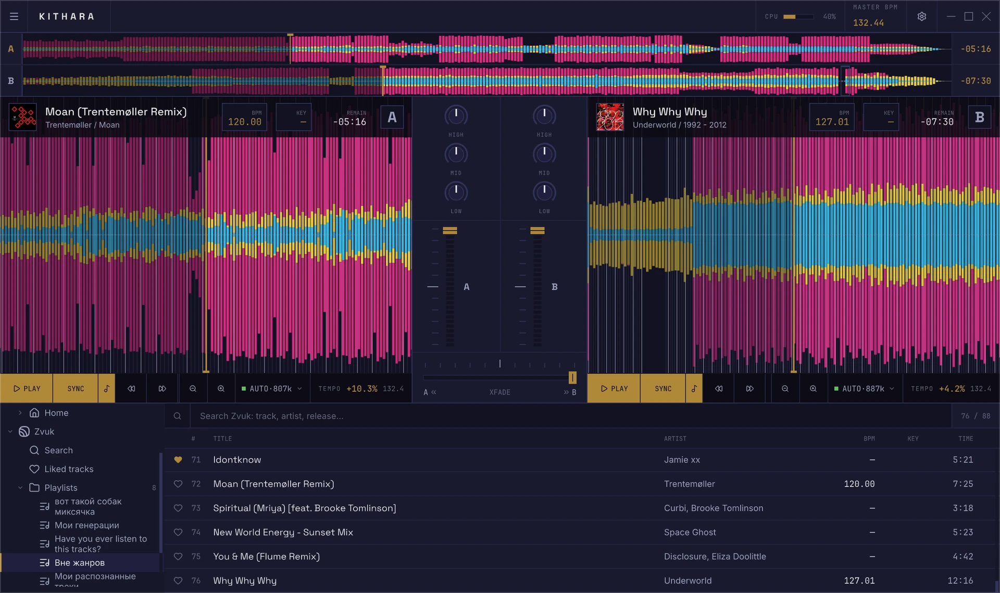

<div align="center">


[](https://crates.io/crates/kithara)
[](https://docs.rs/kithara)
[](LICENSE-MIT)

</div>

# kithara

An audio engine in Rust for streaming players and DJ software. Give it a URL:
HLS (`.m3u8`) plays with adaptive bitrate, anything else streams progressively,
and both are cached on disk. On top sits a multi-deck player with crossfade,
EQ, beat sync, and key-locked tempo.

<p align="center">



</p>

<p align="center"><sub><code>kithara-app</code>, the desktop demo built on the engine.</sub></p>

## Features

- **Streaming** — progressive HTTP and HLS VOD: adaptive bitrate, codec
  switching between variants, AES-128 encrypted segments.
- **Disk cache** — crash-safe writes, LRU eviction, offline playback of cached
  tracks.
- **Decoding** — MP3, AAC (incl. HE-AAC), FLAC, ALAC, WAV, Opus, Vorbis.
  Software decoding through Symphonia, hardware decoding through Apple
  AudioToolbox and Android MediaCodec.
- **DJ playback** — decks, crossfader, 3-band EQ, deck effects, tempo change
  with key lock, beat and BPM analysis, beat sync between decks.
- **Real-time safe** — no allocation in the audio callback; buffers come from a
  preallocated pool.
- **Platforms** — macOS, Linux, Windows, iOS and Android (Swift and Kotlin
  bindings), and the browser (WASM).

## Run the demo

```bash
cargo run -p kithara-app --release                       # the bundled demo playlist
cargo run -p kithara-app --release -- <FILE_OR_URL> ...   # your own files or URLs
```

On Linux install `libasound2-dev` first. To build the browser version, run
`just platform wasm build --package kithara-app`; see
[`kithara-app`](crates/kithara-app/README.md).

## Use as a library

```toml
[dependencies]
kithara = "0.0.1-alpha5"
```

The [`kithara`](crates/kithara/README.md) crate is the entry point: one
`Resource` type reads decoded PCM from a file, URL, or HLS stream. Every layer
is also a crate of its own, so you can take only the HLS client, the cache, or
the decoder. Mobile apps use the [Swift package](apple/README.md) or the
[Android AAR](android/README.md).

## Project status

Pre-release (`0.0.1-alpha`). The public API still changes between releases;
pin an exact version.

## Documentation

- [API reference](https://docs.rs/kithara) on docs.rs.
- [Architecture and crate contracts](https://github.com/zvuk/kithara/wiki/kithara)
  on the wiki.
- [CONTRIBUTING.md](CONTRIBUTING.md) — building, tests, and pull requests.

## Minimum Supported Rust Version

Rust **1.95**, edition 2024 (`rust-version` in the workspace `Cargo.toml`).

## License

Licensed under either of [Apache-2.0](LICENSE-APACHE) or [MIT](LICENSE-MIT) at
your option.
