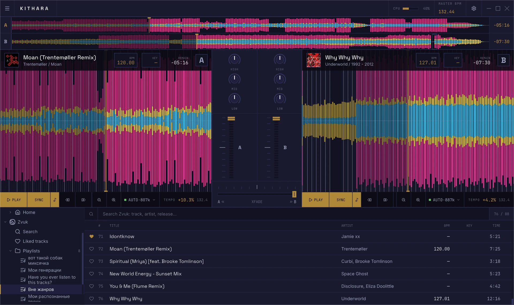

<div align="center">


</div>

<div align="center">

[](https://github.com/zvuk/kithara/blob/main/LICENSE-MIT)

</div>

# kithara-app

The desktop DJ demo built on the engine: two decks with waveforms, BPM and
beat sync, a mixer with EQ and crossfader, tempo with key lock, and a track
library. It also builds for the browser (WebGPU).

<p align="center">



</p>

## Usage

```bash
cargo run -p kithara-app --release -- <FILE_OR_URL> [<FILE_OR_URL> ...]
cargo run -p kithara-app --release -- --help
```

Without arguments the app plays the playlist from its configuration.

### macOS application

```bash
just release app --identity 'Apple Development: Your Name (TEAMID)'
```

Builds `target/release-app/Kithara.app` for Apple Silicon and Intel (macOS 13+),
and writes `Kithara-macos-universal.zip` with its `.sha256` at the workspace
root. `KITHARA_APP_SIGN_IDENTITY` can supply the identity instead. The certificate
and its private key must already be available in the build user's Keychain;
the same protected variable configures the macOS CI release job, which runs
on the protected `kithara-release` runner. No keys are exported by packaging.

The bundle carries the complete default UI package in
`Contents/Resources/assets/ui`, its icon, public configuration and licenses.
CLI `--ui-package` overrides `app.ui_package` in the configuration, which
overrides the bundled package. Paths are resolved from the executable, so
moving the application or starting it from Finder needs no checkout.

The release includes `zvuk` and `keystore`: the stock Zvuk catalogue and account
connection are available, and its account token stays in macOS Keychain.
It uses the existing `app.yaml` and build-time environment/`.env` resolution;
application key values retain their intentional `obfstr` embedding. Set the
referenced application parameters before building: packaging requires them
through the existing `KITHARA_DRM_REQUIRE` check. The `.env` file is not copied
into the application. Its writable configuration lives at
`~/Library/Application Support/Kithara/kithara.yaml`; `--config` selects an
explicit external file. Settings never modify the signed application.

Packaging requires a real signing identity and verifies its signature before
replacing the archive. The archive is **not notarized**. Apple Development can
sign a preview, but does not provide Developer ID distribution trust:
Gatekeeper may require **System Settings > Privacy & Security > Open Anyway**,
and managed Macs can prohibit that override. Public downloads without this
manual approval need Developer ID Application signing and Apple notarization.
Intel runtime validation requires an Intel Mac in addition to the universal
binary checks performed during packaging.

### Configuration

The configuration is `app.yaml`, embedded at build time. A `kithara.yaml`
beside the executable, or a file passed with `--config`, is laid over it:
mappings merge key by key, other values replace what they cover.
`--dump-config` prints the result. Values written as `$KITHARA_...` are read
from the environment or from `.env` in the workspace root at build time. A
DRM provider whose values are missing is turned off with a warning; any other
missing value stops startup.

### Browser

```bash
just platform wasm build --package kithara-app
```

Builds `dist/` for a WebGPU browser. Serve it with cross-origin isolation
(`Cross-Origin-Opener-Policy: same-origin`,
`Cross-Origin-Embedder-Policy: require-corp`); `dist/_headers` sets both on
hosts that read it. The browser build lays `app.web.yaml` over `app.yaml`: no
DRM providers, no catalogue account, and a playlist of cross-origin streams.

## Features

- `gui` (default) — the iced desktop UI; `masonry` adds the retained host
  (`--host retained`).
- `analysis-waveform` (default), `beat-nn-small` (default), `beat-nn-full`,
  `beat-nn-full-int8`, `beat-dsp` — waveform and beat detection.
- `stretch-signalsmith` (default), `stretch-bungee`, `stretch-identity`,
  `stretch-all` — time-stretch engines.
- `zvuk` — Zvuk catalogue: search, liked tracks, playlists; `keystore` keeps
  its token in the OS keychain.
- `broadcast` — serve the master output as a live HLS stream.
- `client-reqwest` / `client-wreq`, `tls-rustls` / `tls-native` — HTTP and TLS.

## Integration

The app only composes and sends commands; playback, mixing, and analysis are
engine features. It caches waveform and beat analysis in memory and on disk
through the shared `AssetStore`. See
[crate contracts](https://github.com/zvuk/kithara/wiki/kithara-app) for the
cache keys and invalidation rules.
