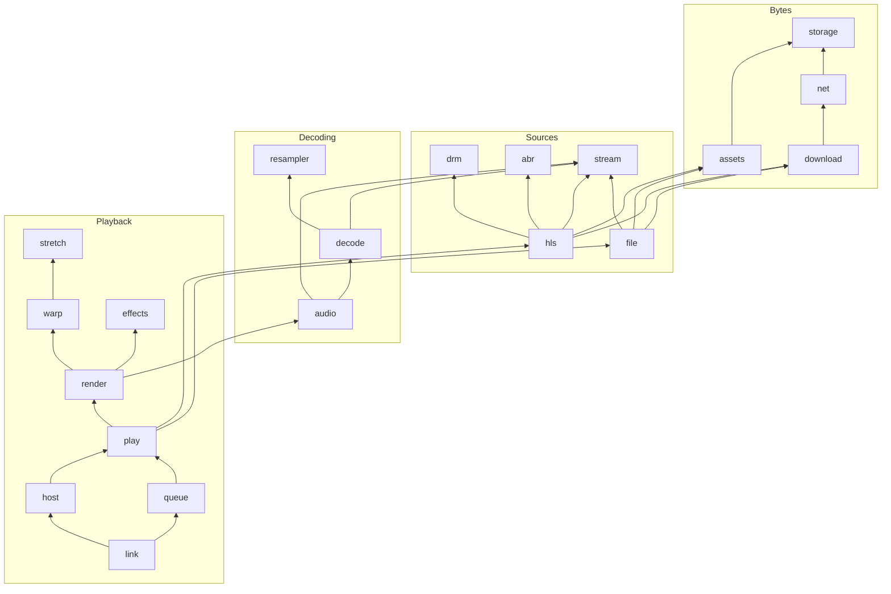

# kithara — Architecture

How the engine crates fit together. Contracts and invariants of each crate are
on its [wiki page](https://github.com/zvuk/kithara/wiki/kithara).

## Layers

Bytes enter at the bottom, PCM leaves at the top. Each box is a crate
(`kithara-` prefix omitted); arrows point from a crate to what it uses.

- **Bytes.** `net` is the HTTP client, `download` schedules requests for all
  sources, `storage` holds file- or memory-backed resources, `assets` is the
  on-disk cache with eviction on top of them.
- **Sources.** `file` (progressive) and `hls` implement the `stream` source
  contract, so a decoder reads both through one `Read + Seek` interface. `abr`
  picks the HLS variant; `drm` decrypts AES-128 segments.
- **Decoding.** `decode` turns bytes into PCM (Symphonia, AudioToolbox,
  MediaCodec); `audio` owns the decoder lifecycle and sample-rate conversion
  through `resampler`.
- **Playback.** `warp` changes tempo with or without key lock (`stretch`
  engines), `render` runs a deck's tracks and `effects` on the audio thread,
  `play` is the player, `queue` a playlist deck, `host` the output session that
  mixes decks, `link` keeps decks on one tempo.

Shared foundations used everywhere: `platform` (sync, time, threads,
cancellation for native and wasm), `bufpool` (preallocated buffers under one
memory budget), `signal` (decoded-audio values), `events` (typed event bus),
`worker` (prioritized task scheduling), `config` (configuration derives).

Analysis runs beside playback: `analysis` computes the `waveform` and `beat`
grid from the same decoded audio; `sync` holds the beat-matching math.

## Threads

- **Audio callback** — the `host` output graph pulls each deck's mix. It does
  not allocate or block; commands reach it as timestamped batches
  (`kithara-command`) and apply at an exact frame.
- **Play worker** — one shared worker decodes, resamples, and time-stretches
  every loaded track into its deck's ring buffer.
- **Async runtime** — network downloads and cache writes.

Events (`kithara-events`) report progress, buffering, and variant switches to
the application. They are a side channel and never block the audio path.

## Key Types

| Type | Role |
| --- | --- |
| `Host` | Output session: owns the device and mixes the decks inserted into it |
| `Queue` | A deck that plays a list of tracks, with crossfade and preload |
| `PlayWorker` | Shared worker that produces PCM for every loaded track |
| `ResourceConfig` | One track: source URL or path, cache, network, decoder options |
| `Resource` | Decoded PCM from one source through the `AudioReader` read/seek interface |
| `PoolRegion` | Buffer pools of one application, sharing one byte budget |
| `EventBus` | Typed event stream for observability |
