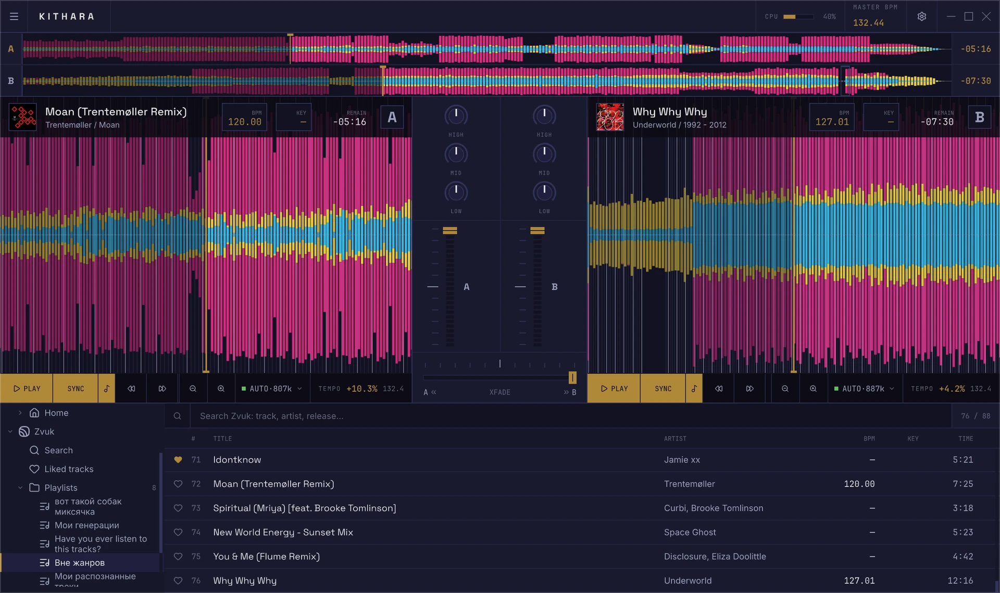

<div align="center">


</div>

<div align="center">

[](https://crates.io/crates/kithara)
[](https://docs.rs/kithara)
[](https://github.com/zvuk/kithara/blob/main/LICENSE-MIT)

</div>

# kithara

An audio engine for streaming players and DJ software. Give it a URL: HLS
(`.m3u8`) plays with adaptive bitrate, anything else streams progressively,
and both are cached on disk. On top sits a multi-deck player with crossfade,
EQ, beat sync, and key-locked tempo.

<p align="center">



</p>

This is the facade crate: each engine layer is a module behind a feature of
the same name (`kithara::hls`, `kithara::play`, `kithara::queue`, ...).

## Usage

Play a list of tracks on the default audio device (features `queue` and the
defaults):

```rust
use kithara::bufpool::{OverallBudget, PoolConfig, pool_schema};
use kithara::host::{Host, HostConfig};
use kithara::play::{PlayWorker, PlayWorkerConfig, ResourcePrep};
use kithara::queue::{Queue, QueueConfig};

pool_schema! {
    pub AppPools {
        bytes: u8,
        samples: f32,
    }
}

#[tokio::main]
async fn main() -> Result<(), Box<dyn std::error::Error>> {
    // One memory budget for every buffer the engine allocates.
    let pool = || PoolConfig::builder().max_buffers(128).build();
    let pools = AppPools::builder(OverallBudget(64 * 1024 * 1024))
        .bytes(pool())
        .samples(pool())
        .build()?;
    let worker = PlayWorker::new(PlayWorkerConfig::builder(pools).build());

    // The Host owns the output device; a Queue is one deck.
    let mut host = Host::new(HostConfig::builder().build())?;
    let deck = host.insert(Queue::new(
        QueueConfig::builder()
            .prep(ResourcePrep::builder().worker(worker).build())
            .should_autoplay(true)
            .build(),
    ))?;
    deck.set_tracks([
        "https://example.com/track.mp3",
        "https://example.com/stream/master.m3u8",
    ])?;

    tokio::signal::ctrl_c().await?;
    Ok(())
}
```

## Features

The defaults give the desktop stack: file and HLS sources, Symphonia decoding,
Rubato resampling, Signalsmith time-stretch, CPAL output, reqwest with rustls.
Commonly added:

- `queue` — playlists and crossfade between tracks (`kithara::queue`).
- `link` — beat sync between decks (`kithara::link`).
- `apple` / `android` — hardware decoders; `apple-net` uses `NSURLSession`.
- `fdk-aac` — HE-AAC through libfdk-aac.
- `offline` / `record` — render without an audio device, record the output.
- `all` — every module with one compatible backend set.
- `test` — test and fixture macro exports with the shared test runtime; select
  it explicitly in test consumers.

With `default-features = false`, enable the engine modules you import.
Production instrumentation macros remain available; test and fixture macros
require `test`. The full feature list is in `Cargo.toml`.

Consumers of `#[kithara::test]` also declare `kithara-test-utils` directly: the
generated wrappers use that crate's runtime. Test-only projects can use its
`kithara` macro re-export instead of the engine facade.

## Integration

The modules are separate crates, so a project can depend on one directly:
`kithara-hls` for an HLS client, `kithara-assets` for the cache,
`kithara-decode` for decoding. See [ARCHITECTURE.md](ARCHITECTURE.md) for how
the layers fit and the [crate contracts](https://github.com/zvuk/kithara/wiki/kithara)
on the wiki.
